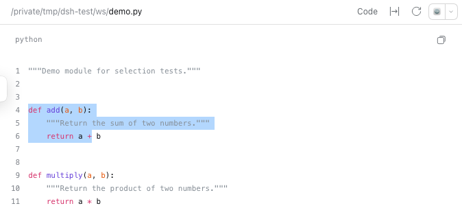
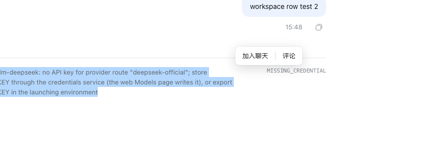
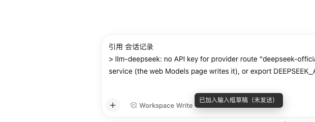
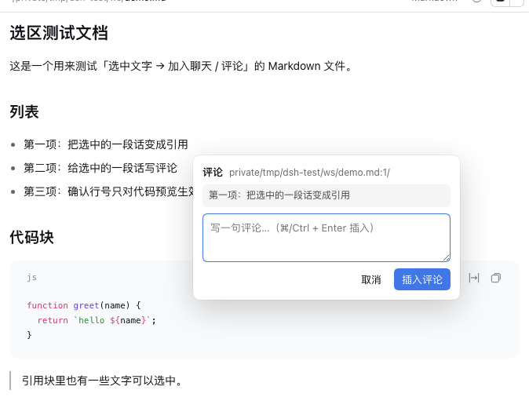
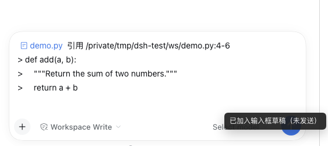
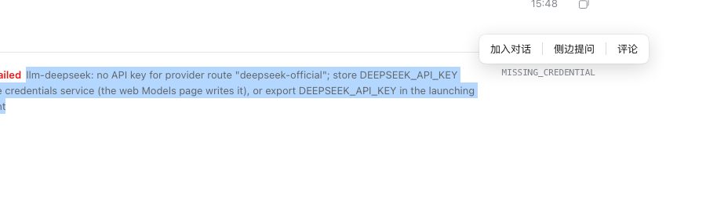

# dsh-selection-chat

在 DeepSeek Harness 里选中一段文字（**右侧栏文件预览正文**，或**聊天记录**），旁边浮出一个小条：

```
选中代码/文档 ──▶ [ 加入对话 | 侧边提问 | 评论 ] ──▶ 写进输入框草稿（不自动发送）
```



聊天记录里选中也行：



选中的聊天文字被引用进草稿：







两个来源都支持：

- **右侧预览正文**：引用带 `文件路径:行号`（代码预览有行号，Markdown/纯文本只给路径）；
- **聊天记录**：引用标注为 `会话记录`（不编造路径）。

**不会触发**的地方（有意）：预览的 tab 条 / 路径头部、输入框里的草稿、app 自己的按钮和标题——这些地方选中文字不会弹浮条。

浮条上三个动作：

- **加入对话**（Codex 的 Add to chat）：把 `文件路径:行号` + 引用正文追加到当前草稿；
- **侧边提问**（Codex 的 Ask in side chat）：开一个侧边聊天，并把这个片段写进**侧边**输入框草稿（需要同时装 `@xywen97/dsh-sidechat`）；
- **评论**（Claude Code 的选中加 comment）：弹小输入框，写完把「引用 + 我的评论」追加到草稿；
- 三者都**只填草稿，绝不自动发送**。



## 安装

已发布到 npm：`dsh-selection-chat@0.1.0`。


一条命令装好（npm / git 二选一）：

```sh
# npm（推荐）
dsh plugin --profile desktop add dsh-selection-chat

# 或直接钉 Git 提交（未发布 npm 时可用）
dsh plugin --profile desktop add "git+https://github.com/xywen97/dsh-selection-chat.git"
```

也可以走桌面版 `设置 → 插件 → 安装`，spec 填 `dsh-selection-chat`。
装完几秒内热加载生效（必要时 `Cmd/Ctrl + R` 刷新窗口）。

### 配套插件

「侧边提问」动作需要同作者的侧边聊天插件：

```sh
dsh plugin --profile desktop add @xywen97/dsh-sidechat
```

没装也能用「加入对话 / 评论」，点「侧边提问」会提示先装。

## 使用

1. 在**聊天记录**里拖选一段文字，或在**右侧栏预览正文**里拖选（点 `@文件` 引用芯片 / 右侧栏 Files 可打开预览）；
2. 松手后浮条出现；
3. 选区旁出现 `加入对话 | 侧边提问 | 评论`：
   - 点 **加入对话** → 草稿末尾出现形如下面的引用块，toast 提示「已加入输入框草稿（未发送）」；
   - 点 **评论** → 输入评论，`⌘/Ctrl + Enter` 或点 **插入评论** → 草稿里出现评论块；
4. `Esc` / 点空白处收起浮层。

### 生成的内容

```text
引用 /private/tmp/dsh-test/ws/demo.py:4-6
> def add(a, b):
>     """Return the sum of two numbers."""
>     return a + b

```

```text
评论 /private/tmp/dsh-test/ws/demo.md
> 第二项：给选中的一段话写评论
我的评论：这条可以合并进上一条

```

- 行号只在**代码预览**里有（Shiki 每行一个 `.line`，可以精确数）；
- Markdown / 纯文本预览只给路径，不给行号；
- 拖选时首尾的空行会自动去掉，行号跟着往内收。

## 行为约束

| 场景 | 行为 |
|---|---|
| 选区在输入框里 | 不出现浮条（不引用自己正在写的草稿） |
| 选区在预览 tab 条 / 路径头部 | 不出现浮条（那里是 app chrome，不是文件内容） |
| 选区在聊天记录里 | 出现浮条，引用标注为 `会话记录` |
| 侧边聊天面板打开时 | 浮条的写入目标仍是**主对话**（侧边面板的输入框不会被抢） |
| 会话正在提交（草稿被锁） | 重试一次；仍失败则**复制到剪贴板**并提示，不会静默吞掉 |
| 没拿到 `inputActions` | 同上：退剪贴板 + 提示 |
| 写评论时点浮层外面 | 视为放弃，收起气泡 |
| 浮层与窗口 | 浮层**按需创建**、本体是 0×0 容器（只有按钮/气泡是可见尺寸），空闲时直接从 DOM 摘掉；不会遮挡 Electron 的窗口拖拽区 / 双击标题栏全屏 |
| 插件被卸载/热重载 | 摘掉全部 DOM 监听、样式和浮层 |

## 依赖的宿主契约（0.2.x 实测）

- 槽位 `conversation.input.dock`（session 作用域）的 props 里带
  `inputActions = { captureInsertion(), insertText(text, span), setDraft(), submit(), addAttachments() }`；
  本插件只用 `captureInsertion` + `insertText`，**不碰 `submit`**。
- 预览正文槽位：`[data-slot="sidebar.right.tab.document"]`（只认它，不认 tab 条/头部）
- 预览根：`[data-document-preview="<renderer id>"]`
- 文件路径：`[data-textpreview-path][title]`（绝对路径）
- 聊天记录：`[data-slot="conversation.chat.flow"]` / `conversation.chat.node`
- 代码行：`pre > code > span.line`（Shiki），按顺序数即可
- 右侧栏 tab 容器：`[data-sidebar-right-tab]`

宿主改这些标记时插件会**静默降级**：浮条还能出，只是路径/行号缺失或插入走剪贴板。

## 已验证

在独立 DSH_HOME + 独立端口（隔离的 web profile）上用无头 Chrome 实测过：

- 代码预览真人鼠标拖选 3 行 → 浮条出现 → 引用块行号 `4-6` 正确；
- Markdown 预览选正文段落 → 引用块只带路径，没有假行号；
- 评论气泡 → 输入 → `插入评论` → 草稿内容正确；
- 输入框内选区不触发浮条；点空白处 / `Esc` 收起；
- 聊天记录里拖选 → 浮条 → 引用块标注 `会话记录`；
- 预览 tab 条 / 路径头部、输入框里选中 → 不出现浮条；
- 勾选进草稿后**没有**任何自动发送行为；
- 在运行中的宿主上**装/卸插件**（改 profile 的 package.json）→ 已打开的页面几秒内自动挂载/卸载本插件，全程无报错。

## 文件

```
package.json        # dsh.bundle.patch + dsh.client(platform=web) + exports["./client"]
cordis.patch.yml    # 插件自带的挂载声明（insert 一行）
index.js            # host 半端：空 apply（本插件没有 host 能力）
client.js           # 浏览器半端：选区监听、浮条/评论气泡、insertText 写入
docs/*.png          # 截图
```

## 已知限制

- 只认右侧栏预览；PDF/Office/表格预览里的选区没有文本锚点，不处理；
- 没有「评论锚点持久化」（评论是插进聊天的一条消息，不是钉在文件上的批注）；
- 浮条位置按选区矩形算，跨屏滚动/缩放会跟随重算，但极端窄窗口下可能盖住内容；
- 行号依赖 Shiki 的 `.line` 结构，宿主换渲染器时行号会降级为「只给路径」。
